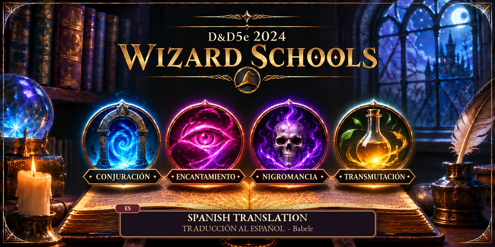
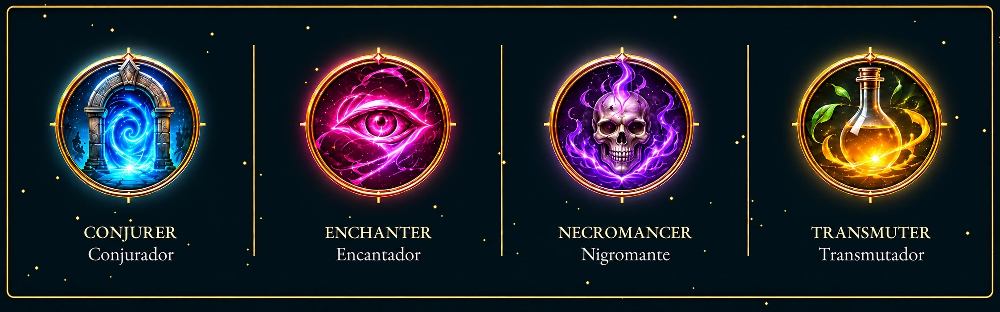
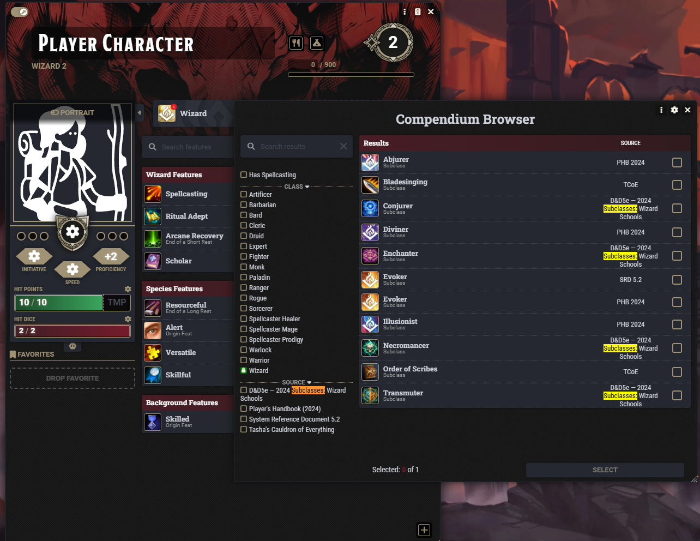
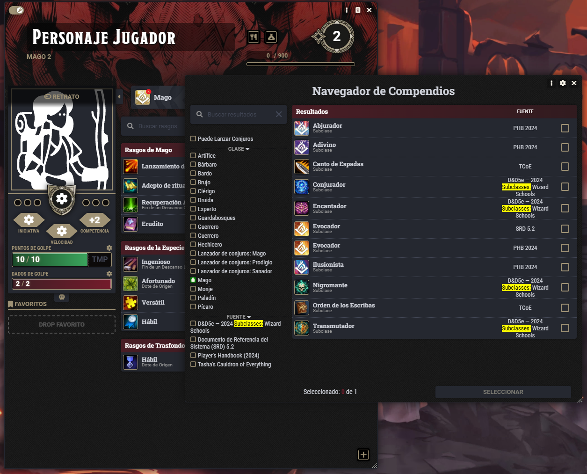

# D&D 2024 — Wizard Schools: Spanish Translation

[Español](README.md) | **English**

<p align="center">
  
</p>

     

 
[](https://github.com/foundryvtt-sinregistrar/translate-dnd5e-wizard-schools-2024-es/releases/latest)
[](https://github.com/foundryvtt-sinregistrar/translate-dnd5e-wizard-schools-2024-es/releases)

Babele translation for **D&D 2024 — Wizard Schools**. It translates the four folders and all visible fields of their 24 documents by stable ID, without duplicating the base compendium.

## Status

Compatible with Foundry VTT 14.367 or newer, dnd5e 6.0.3 or newer, Babele 2.9.1 or newer, and base module 2.14.0 or newer.

## Requirements

- Foundry VTT 14.367 or newer.
- The dnd5e system 6.0.3 or newer.
- `dnd5e-2024-wizard-schools` 2.14.0 or newer.
- The official PHB 2024 module.
- Babele 2.9.1 or newer.

## Installation

Install from Foundry using this manifest:

```text
https://github.com/foundryvtt-sinregistrar/translate-dnd5e-wizard-schools-2024-es/releases/latest/download/module.json
```

## Activation and use

Enable the translation, base module, Babele, PHB 2024, and dnd5e. Select Spanish as Foundry's language and reload the world.

## Updating

Update the base module before the translation. Imported actor copies do not synchronize automatically.

## Included content

Translates the four folders and their 24 documents while preserving document, activity, effect, and advancement IDs.

## Limitations

It translates visible fields only; it neither replaces nor duplicates documents, and it does not modify base-module mechanical data.

## Support and contributions

Report issues in the [translation repository](https://github.com/foundryvtt-sinregistrar/translate-dnd5e-wizard-schools-2024-es/issues).

## Development

This repository is the template for other translations. Register only the target language in `babele-register.mjs` and retain every ID in the translation JSON. See [CHANGELOG.md](CHANGELOG.md) for version history.

## Screenshots

The four Wizard schools included in the translation:



Choosing a Wizard school when the character reaches level 3, with the base compendium in English:



The same screen with the Spanish translation enabled:



See also the [public Foundry package description](docs/foundry/description-foundry.html).

## License and credits

See [LICENSE.md](LICENSE.md). Published releases contain the installable ZIP, external `module.json`, and `SHA256SUMS.txt`.
